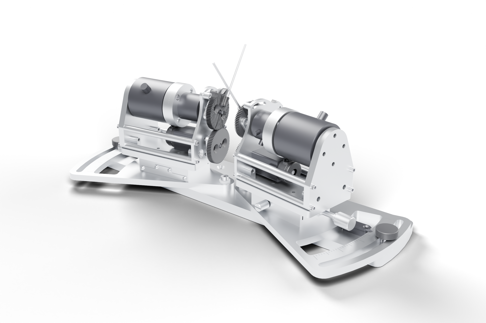
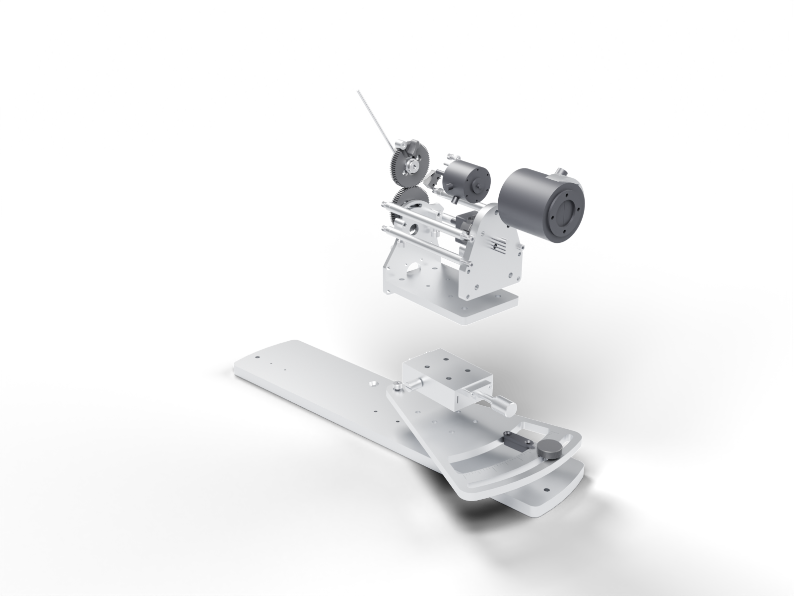

# mouse-joysticks-mech

Mechanical model of the dual lever assembly in the Janelia Dudman lab
joystick rig: the two mirrored joystick mechanisms that the rig's two
[mouse-joystick-pcb](https://github.com/peterpolidoro/mouse-joystick-pcb)
controller boards drive, one board per joystick. The model is exported
geometry; this repository adds renders of it, a registry of every part and
generated pages that say what each part is and which board circuit and
firmware it meets.

| File | Format | Size | Use |
| --- | --- | --- | --- |
| `mouse-joysticks.stp` | STEP AP214 | 22.6 MB | Open in FreeCAD, Fusion, Inventor, SolidWorks or Onshape to measure, mate against or modify |
| `mouse-joysticks.glb` | glTF 2.0 binary | 11.3 MB | Open in any glTF viewer or in Blender to look at the assembly |
| `docs/renders/` | PNG | | Renders of the assembly, one station, exploded views and every part in isolation, generated from the model ([how](atlas/README.md)); the same pages and pictures make [the atlas site](https://peterpolidoro.github.io/mouse-joysticks-mech/) |
| `docs/` | Markdown | | [One station](docs/station.md), [the parts](docs/components/README.md), [the mechanical BOM](docs/bom-mechanical.md), [the model's frame and units](docs/model.md) |
| `atlas/` | YAML, Python | | The part registry and the scripts that generate the renders and pages |
| `manual/` | YAML, Python | | The PDF manual of the whole rig, assembled from the four repositories' pages at their tagged revisions ([how](manual/README.md)); attached to each release of this repository |

The assembly was designed and modelled by Sam Jager (Janelia Research
Campus) in Autodesk Inventor 2025 and exported to STEP on 2026-07-22; the
STEP header records the file as `Dual Lever Assembly.stp`. The native
Inventor files are not in this repository.

## One Station

Each joystick station is a motor driving the lever through a spur gear pair,
with a magnetic particle brake and a reaction torque sensor on the lever
axis, a limit switch at the end of travel and an encoder, all on a frame
that slides on a linear stage and rotates on the base plate. The
[station page](docs/station.md) shows it exploded and
[each part](docs/components/README.md) has a page with its render, vendor
part number, datasheet, the board connector it reaches and the firmware
that drives it.

## How The Boards Relate To It

The left mechanism is a mirror of the right one. The controller boards and
their firmware are identical for both joysticks; the reversal is made in the
motor and encoder cables, which [the harness pinouts](https://github.com/peterpolidoro/mouse-joystick-pcb/blob/main/docs/harness-pinouts.md)
in the board repository describe. Where the controller boards mount is an
enclosure decision, not something this model fixes; the boards' outlines,
mounting holes and connector positions are in their generated documentation.
The model predates the brake and torque sensor interfaces on the v1.0
controller board and does not record how those parts mount.

The boards in this render stand where the 2026-09-21 placement study put
them, as a study and not a fixture; the board models are the PCB
repositories' own exports (`atlas/boards/PROVENANCE.md`).

## Related Repositories

- [mouse-joystick-pcb](https://github.com/peterpolidoro/mouse-joystick-pcb): the joystick controller board, its protocol and its bring-up log.
- [mouse-joystick-firm](https://github.com/peterpolidoro/mouse-joystick-firm): the board's firmware and the pyControl device class.
- [camera-gpio-interface-pcb](https://github.com/peterpolidoro/camera-gpio-interface-pcb): the rig's camera interface board.
- [joystick-rig](https://github.com/sourishmukh/joystick-rig): the rig's pyControl tasks, hardware definition and operating notes.

## License

CC-BY-SA-4.0; see [LICENSE](LICENSE).

## Citation

[CITATION.cff](CITATION.cff) carries the citation metadata; GitHub renders it
under "Cite this repository".
