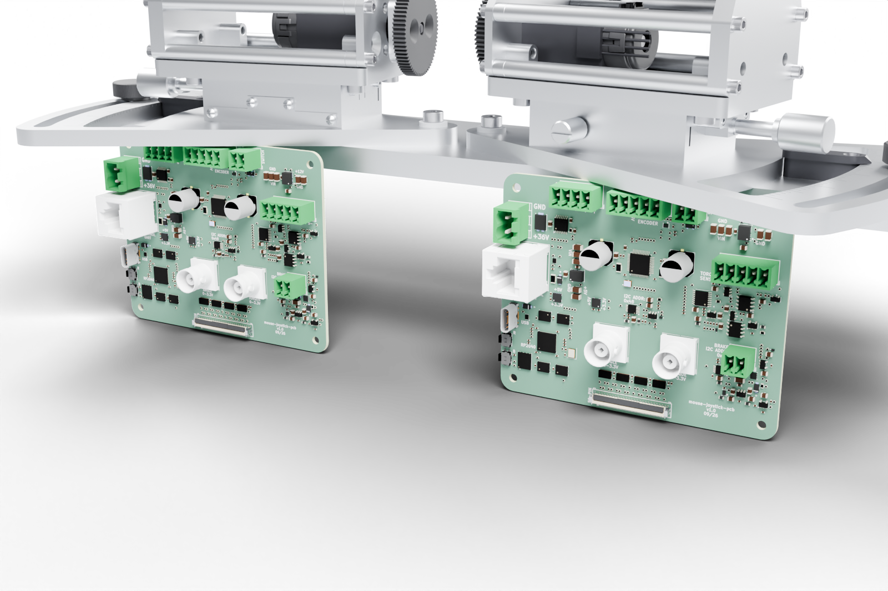
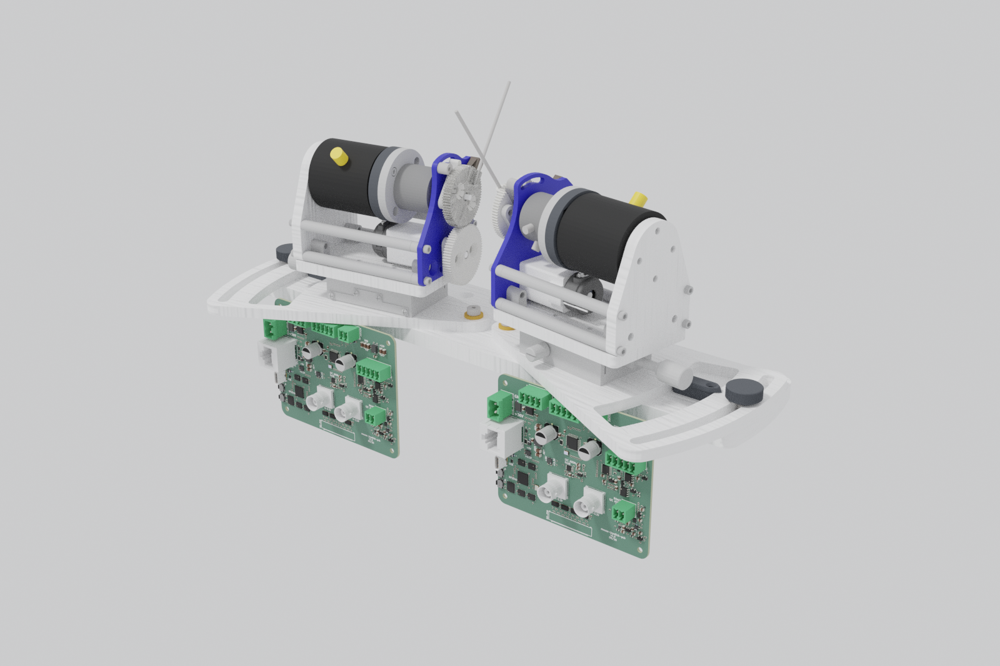

# Boards

The rig's two circuit boards. Each has its own repository with the schematic,
the layout, the fabrication package, the generated documentation and the
bring-up record; this page is the door to them. The pictures are the board
repositories' own renders at the tagged revision, or at `main` where the
repository has no tag yet.

## Joystick controller board

One per station: RP2040, TMC5130A driver, brake current sink, torque bridge, angle and torque analog outputs, pyControl UART on an RJ-45. Placement in the renders follows the 2026-09-21 placement study and is not a fixture.

| | |
| --- | --- |
| Repository | [mouse-joystick-pcb](https://github.com/peterpolidoro/mouse-joystick-pcb) at `v1.0` |
| Where it sits | one per station, under the mechanism in the placement study |
| Start with | [README](https://github.com/peterpolidoro/mouse-joystick-pcb/blob/v1.0/README.md), [interface map](https://github.com/peterpolidoro/mouse-joystick-pcb/blob/v1.0/docs/interface-map.md) |
| Generated documentation | [schematic, renders, BOM, geometry](https://github.com/peterpolidoro/mouse-joystick-pcb/blob/v1.0/docs/generated/README.md) |
| Fabrication | [the package the boards were ordered from](https://github.com/peterpolidoro/mouse-joystick-pcb/tree/v1.0/fab) |

Also: the [UART protocol](https://github.com/peterpolidoro/mouse-joystick-pcb/blob/v1.0/docs/uart-protocol.md) pyControl speaks to it, the
[harness pinouts](https://github.com/peterpolidoro/mouse-joystick-pcb/blob/v1.0/docs/harness-pinouts.md), [power](https://github.com/peterpolidoro/mouse-joystick-pcb/blob/v1.0/docs/power.md),
and the [bring-up log](https://github.com/peterpolidoro/mouse-joystick-pcb/blob/v1.0/docs/bringup-log.md) with every measurement by board serial.
The firmware is [mouse-joystick-firm](https://github.com/peterpolidoro/mouse-joystick-firm) (`v1.0.0`); its
[architecture page](https://github.com/peterpolidoro/mouse-joystick-firm/blob/main/docs/architecture.md) and
[circuit-to-code map](https://github.com/peterpolidoro/mouse-joystick-firm/blob/main/docs/circuit-code-map.md) say which code drives which circuit.

The boards in the placement study stand under their stations, terminal
blocks up; where they finally mount is an enclosure decision. The camera
interface board stands in their row beyond the end of the base plate only
so that one picture shows every board of Rig 1; on the rig it sits by the
cameras.

## Camera GPIO interface board

Between pyControl and the three Blackfly S cameras; strobes and sync to the OneBox. Rig 1 only.

| | |
| --- | --- |
| Repository | [camera-gpio-interface-pcb](https://github.com/peterpolidoro/camera-gpio-interface-pcb) at `v1.0` |
| Where it sits | one per rig, between pyControl and the cameras (Rig 1 only) |
| Start with | [README](https://github.com/peterpolidoro/camera-gpio-interface-pcb/blob/v1.0/README.md), [interface map](https://github.com/peterpolidoro/camera-gpio-interface-pcb/blob/v1.0/docs/interface-map.md) |
| Generated documentation | [schematic, renders, BOM, geometry](https://github.com/peterpolidoro/camera-gpio-interface-pcb/blob/v1.0/docs/generated/README.md) |
| Fabrication | [the package the boards were ordered from](https://github.com/peterpolidoro/camera-gpio-interface-pcb/tree/v1.0/fab) |

