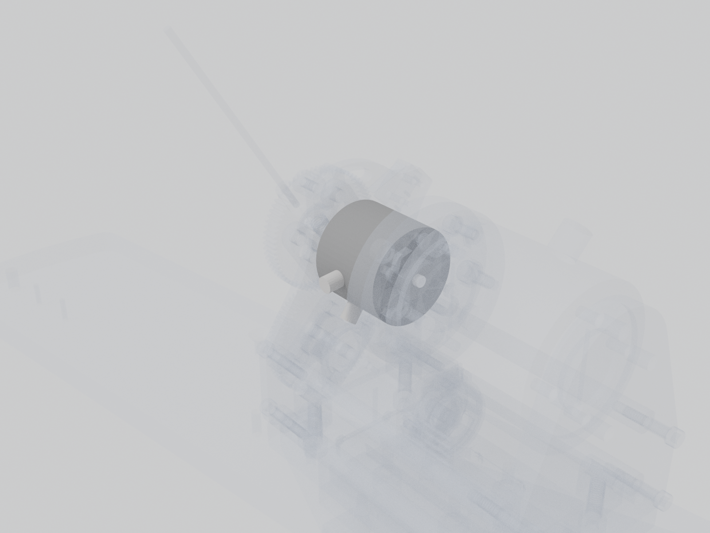

# Magnetic particle brake

On the lever axis behind the gear. The board's current sink drives its coil from 0 to about 49 mA to set the resistance the mouse feels while the lever is released.

| | |
| --- | --- |
| Vendor | Placid Industries |
| Part number | `B5Z-1R` |
| Datasheet | [`mouse-joystick-pcb/docs/datasheets/brake.pdf`](https://github.com/peterpolidoro/mouse-joystick-pcb/blob/v1.0/docs/datasheets/brake.pdf) |
| Where | one per station |
| Model nodes | `PLACID INDUSTRIES B5Z-1R:*` |

## Connection

| Board | Connector | Cable |
| --- | --- | --- |
| [mouse-joystick-pcb](https://github.com/peterpolidoro/mouse-joystick-pcb/blob/v1.0/docs/interface-map.md) | `J1801` | [Brake coil lead](brake-lead.md) |

## Circuit

Schematic block `brake_torque_sensor/brake_current_sink_0_49ma_dac80501` on the joystick board. The block's own page is generated in the board repository (`docs/generated/blocks/`); until it exists, the [interface map](https://github.com/peterpolidoro/mouse-joystick-pcb/blob/v1.0/docs/interface-map.md) and the [schematic PDF](https://github.com/peterpolidoro/mouse-joystick-pcb/blob/v1.0/docs/generated/schematic/mouse-joystick-pcb-schematic.pdf) cover it.

## Firmware

Files: [`mouse-joystick-firm/src/BrakeTorqueHw.hpp`](https://github.com/peterpolidoro/mouse-joystick-firm/blob/main/src/BrakeTorqueHw.hpp), [`mouse-joystick-firm/src/BrakeTorqueBackend.hpp`](https://github.com/peterpolidoro/mouse-joystick-firm/blob/main/src/BrakeTorqueBackend.hpp), [`mouse-joystick-firm/src/DAC80501Device.hpp`](https://github.com/peterpolidoro/mouse-joystick-firm/blob/main/src/DAC80501Device.hpp)

Protocol: `BRAKE`, `ev RELEASED`, `~BRAKE_FAULT in the fault mask` ([protocol](https://github.com/peterpolidoro/mouse-joystick-pcb/blob/v1.0/docs/uart-protocol.md))

Proved by: [`mouse-joystick-firm/examples/BrakeAndTorque`](https://github.com/peterpolidoro/mouse-joystick-firm/blob/main/examples/BrakeAndTorque), [`mouse-joystick-firm/docs/brake-torque-bringup.md`](https://github.com/peterpolidoro/mouse-joystick-firm/blob/main/docs/brake-torque-bringup.md); measurements in the [bring-up log](https://github.com/peterpolidoro/mouse-joystick-pcb/blob/v1.0/docs/bringup-log.md) by board serial.

---

Generated by `atlas/pages.py` from `atlas/components.yaml`; edit the registry, not this page.
