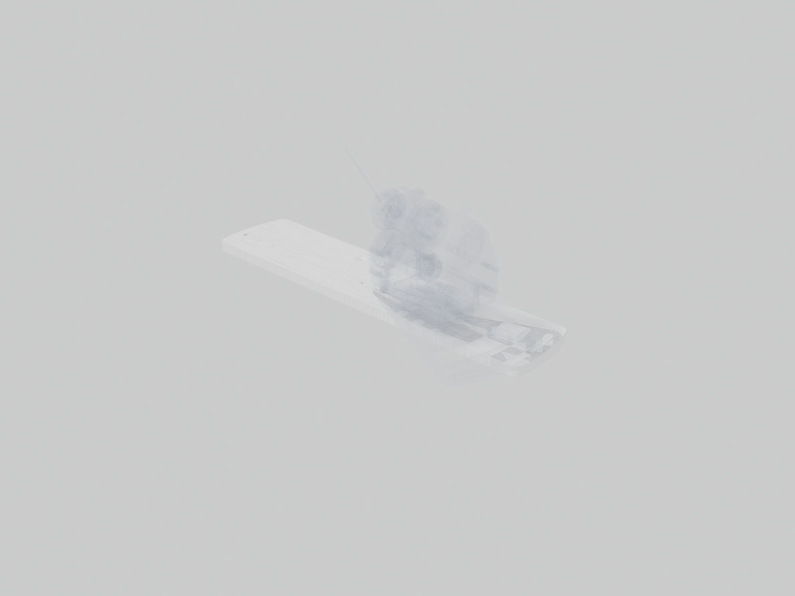

# Dual base plate

The common base both stations rotate and slide on; 349 by 76 mm.

| | |
| --- | --- |
| Vendor | Janelia (custom) |
| Where | one per rig |
| Model nodes | `DUAL BASE PLATE:*` |

---

Generated by `atlas/pages.py` from `atlas/components.yaml`; edit the registry, not this page.
