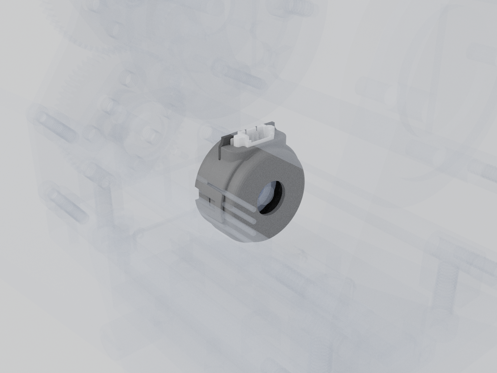

# Lever-axis encoder

Optical kit encoder. Its A and B channels reach the board's encoder input and are counted by the TMC5130A, not by the RP2040; the firmware reads the count over SPI.

| | |
| --- | --- |
| Vendor | US Digital |
| Part number | `E4T-200-157-S-H-M-B` |
| Datasheet | [`mouse-joystick-pcb/docs/datasheets/encoder.pdf`](https://github.com/peterpolidoro/mouse-joystick-pcb/blob/v1.0/docs/datasheets/encoder.pdf) |
| Where | one per station |
| Model nodes | `US DIGITAL E4T-200-157-S-H-M-B:*` |

## Connection

| Board | Connector | Cable |
| --- | --- | --- |
| [mouse-joystick-pcb](https://github.com/peterpolidoro/mouse-joystick-pcb/blob/v1.0/docs/interface-map.md) | `J1103` | [Joystick harness (motor, encoder, limit switch)](harness.md) |

## Circuit

Schematic block `motor_encoder_switch/quadrature_encoder_input_5v_sn74lvc2g17` on the joystick board. The block's own page is generated in the board repository (`docs/generated/blocks/`); until it exists, the [interface map](https://github.com/peterpolidoro/mouse-joystick-pcb/blob/v1.0/docs/interface-map.md) and the [schematic PDF](https://github.com/peterpolidoro/mouse-joystick-pcb/blob/v1.0/docs/generated/schematic/mouse-joystick-pcb-schematic.pdf) cover it.

## Firmware

Files: [`mouse-joystick-firm/src/TmcMotion.hpp`](https://github.com/peterpolidoro/mouse-joystick-firm/blob/v1.0.0/src/TmcMotion.hpp), [`mouse-joystick-firm/src/Conversions.hpp`](https://github.com/peterpolidoro/mouse-joystick-firm/blob/v1.0.0/src/Conversions.hpp)

Protocol: `STATUS (angle)`, `ev TARGET` ([protocol](https://github.com/peterpolidoro/mouse-joystick-pcb/blob/v1.0/docs/uart-protocol.md))

Proved by: [`mouse-joystick-firm/examples/MotionAndHoming`](https://github.com/peterpolidoro/mouse-joystick-firm/blob/v1.0.0/examples/MotionAndHoming), [`mouse-joystick-firm/docs/motion-bringup.md`](https://github.com/peterpolidoro/mouse-joystick-firm/blob/v1.0.0/docs/motion-bringup.md); measurements in the [bring-up log](https://github.com/peterpolidoro/mouse-joystick-pcb/blob/v1.0/docs/bringup-log.md) by board serial.

## To confirm

- The model names a 200 CPR disk (E4T-200) while the bring-up log confirms 1000 CPR against 51200 microsteps per revolution; which part is fitted?

---

Generated by `atlas/pages.py` from `atlas/components.yaml`; edit the registry, not this page.
