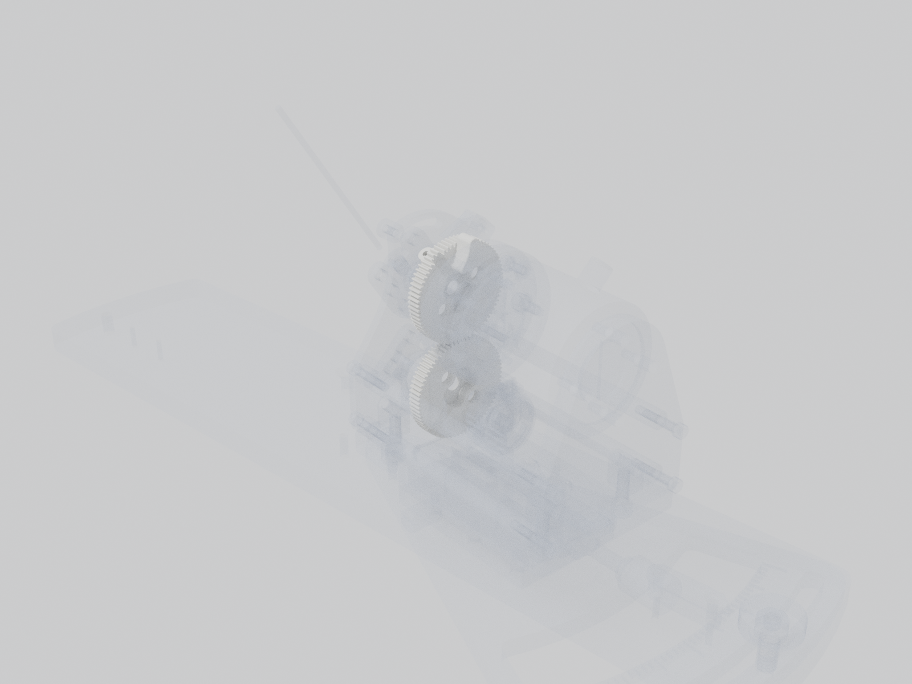

# Spur gear pair

Driving gear on the motor shaft, driven gear on the lever axis. The mirrored station has its own driven gear. The gear ratio is the number the firmware's angle scaling depends on.

| | |
| --- | --- |
| Vendor | Janelia (custom) |
| Where | one per station |
| Model nodes | `Spur Gears:*`, `DRIVEN SPUR GEAR MIR:*` |

## Firmware

Files: [`mouse-joystick-firm/src/Conversions.hpp`](https://github.com/peterpolidoro/mouse-joystick-firm/blob/v1.0.0/src/Conversions.hpp)

gear ratio and microsteps per lever degree live here

## To confirm

- Tooth counts of the driving and driven gears, to check against src/Conversions.hpp.

---

Generated by `atlas/pages.py` from `atlas/components.yaml`; edit the registry, not this page.
