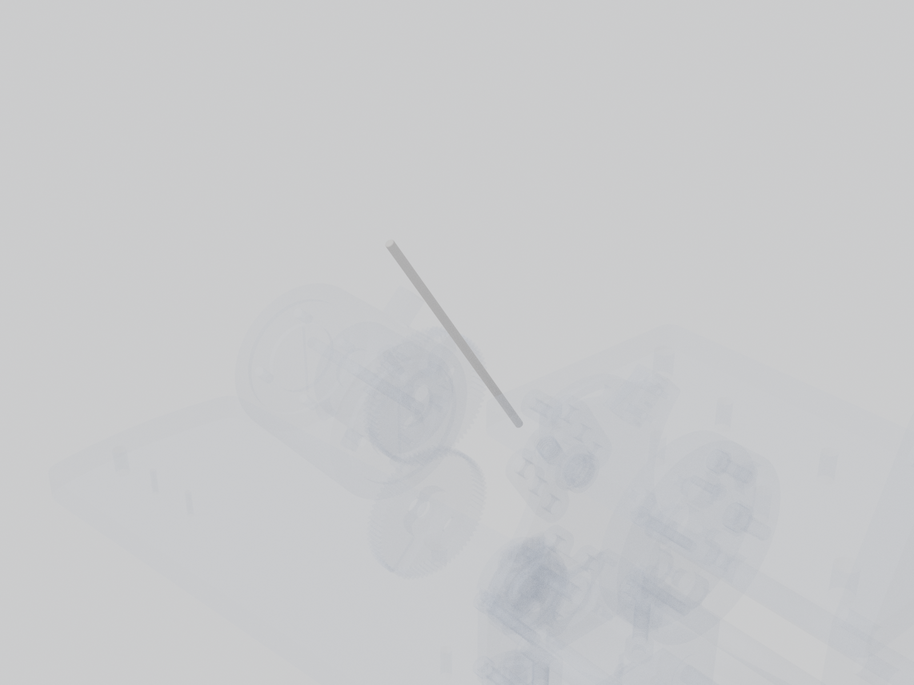

# Joystick lever

The lever the mouse holds. Rides on the lever axis at the front of the station; a pull moves it toward decreasing angle on both stations.

| | |
| --- | --- |
| Vendor | Janelia (custom) |
| Where | one per station |
| Model nodes | `MCL LEVER:*` |

## To confirm

- Material and finish of the lever (not in the model).

---

Generated by `atlas/pages.py` from `atlas/components.yaml`; edit the registry, not this page.
