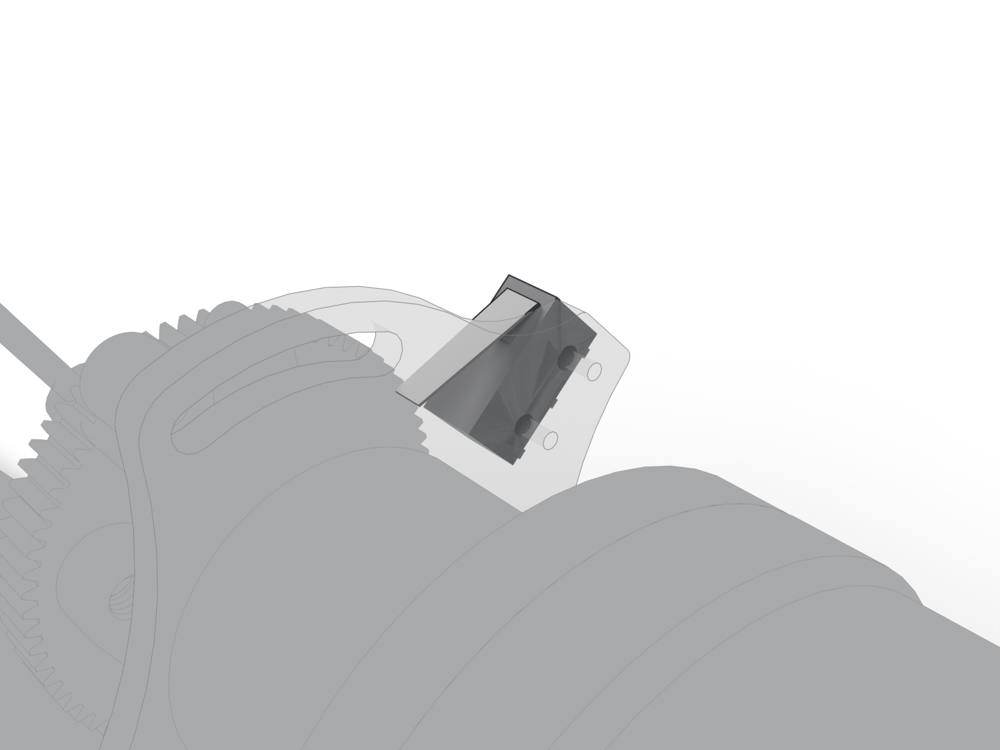

# Limit switch

Subminiature basic switch with a lever actuator at the positive end of travel. The firmware homes against it and uses it as the hardware stop for negative motion through the driver's reference input.

| | |
| --- | --- |
| Vendor | Omron |
| Part number | `D2F-01FL` |
| Where | one per station |
| Model nodes | `D2F_01FL:*` |

## Connection

| Board | Connector | Cable |
| --- | --- | --- |
| [mouse-joystick-pcb](https://github.com/peterpolidoro/mouse-joystick-pcb/blob/v1.0/docs/interface-map.md) | `J1601` | [Joystick harness (motor, encoder, limit switch)](harness.md) |

## Circuit

Schematic block `motor_encoder_switch/limit_switch_debounced_input_vertical` on the joystick board: [its page](https://peterpolidoro.github.io/mouse-joystick-pcb/generated/blocks/limit_switch_debounced_input_vertical/) on the board's site has the schematic, the parts with their sourcing, the ports and where the block sits on the board; the [interface map](https://github.com/peterpolidoro/mouse-joystick-pcb/blob/v1.0/docs/interface-map.md) and the [schematic PDF](https://github.com/peterpolidoro/mouse-joystick-pcb/blob/v1.0/docs/generated/schematic/mouse-joystick-pcb-schematic.pdf) at the tagged revision cover the rest.

## Firmware

Files: [`mouse-joystick-firm/src/MotionSetup.hpp`](https://github.com/peterpolidoro/mouse-joystick-firm/blob/v1.0.0/src/MotionSetup.hpp), [`mouse-joystick-firm/src/TmcMotion.hpp`](https://github.com/peterpolidoro/mouse-joystick-firm/blob/v1.0.0/src/TmcMotion.hpp)

Protocol: `HOME`, `ev HOMED` ([protocol](https://github.com/peterpolidoro/mouse-joystick-pcb/blob/v1.0/docs/uart-protocol.md))

Proved by: [`mouse-joystick-firm/examples/MotionAndHoming`](https://github.com/peterpolidoro/mouse-joystick-firm/blob/v1.0.0/examples/MotionAndHoming); measurements in the [bring-up log](https://github.com/peterpolidoro/mouse-joystick-pcb/blob/v1.0/docs/bringup-log.md) by board serial.

---

Generated by `atlas/pages.py` from `atlas/components.yaml`; edit the registry, not this page.
