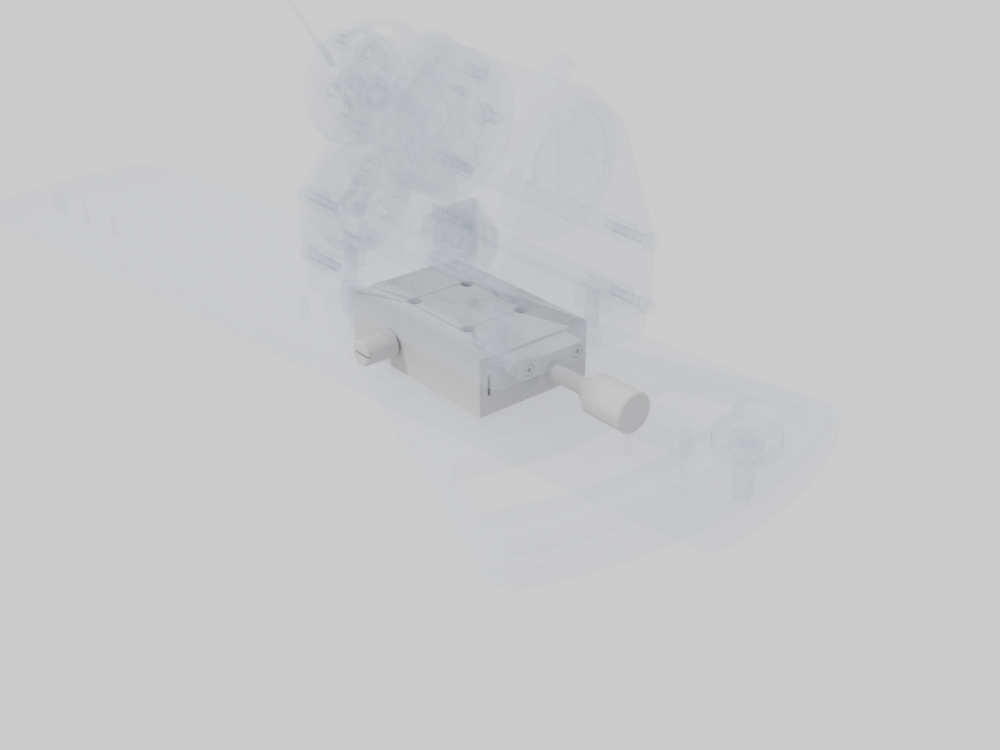

# Linear stage

Base and carriage. Lets the whole station slide along the base plate's long axis to set the lever's distance from the mouse.

| | |
| --- | --- |
| Vendor | Misumi |
| Part number | `XSLC60` |
| Where | one per station |
| Model nodes | `MISUMI XSLC60:*` |

## To confirm

- Full Misumi part number (travel and options).

---

Generated by `atlas/pages.py` from `atlas/components.yaml`; edit the registry, not this page.
