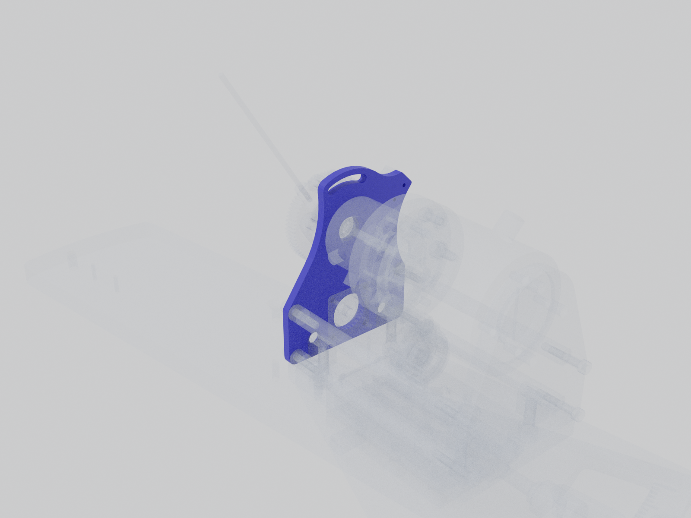

# Motor mount plate

Vertical plate at the front of the station carrying the motor and the front of the lever axis; mirrored on the left station.

| | |
| --- | --- |
| Vendor | Janelia (custom) |
| Where | one per station |
| Model nodes | `MOTOR MOUNT PLATE:*`, `MOTOR MOUNT PLATE_MIR:*` |

---

Generated by `atlas/pages.py` from `atlas/components.yaml`; edit the registry, not this page.
