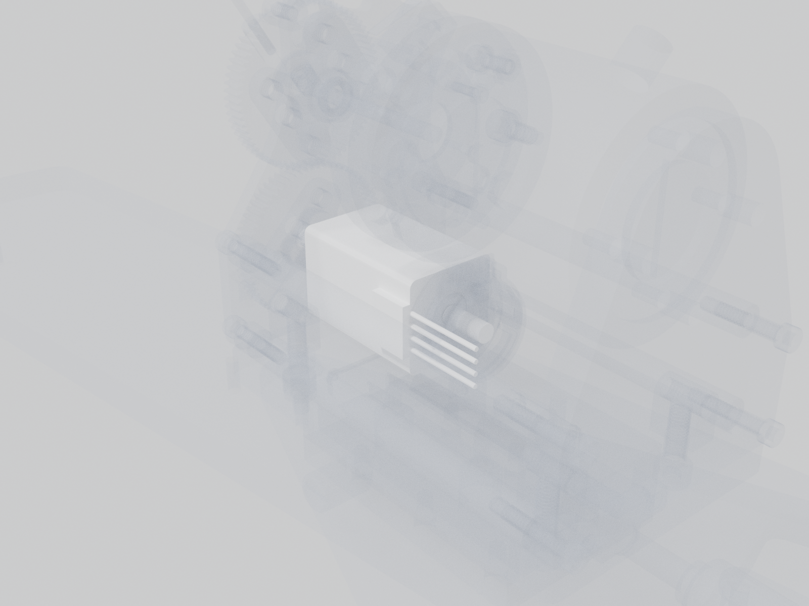

# Stepper motor

The motor that presents, parks and homes the lever through the gear pair. Rated 0.6 A per phase; the firmware runs it below that.

| | |
| --- | --- |
| Vendor | Lin Engineering |
| Part number | `208-13-01D` |
| Datasheet | [`mouse-joystick-pcb/docs/datasheets/motor.pdf`](https://github.com/peterpolidoro/mouse-joystick-pcb/blob/v1.0/docs/datasheets/motor.pdf) |
| Where | one per station |
| Model nodes | `LIN ENGINEERING 208-13-01D:*` |

## Connection

| Board | Connector | Cable |
| --- | --- | --- |
| [mouse-joystick-pcb](https://github.com/peterpolidoro/mouse-joystick-pcb/blob/v1.0/docs/interface-map.md) | `J1102` | [Joystick harness (motor, encoder, limit switch)](harness.md) |

## Circuit

Schematic block `motor_encoder_switch/tmc5130` on the joystick board. The block's own page is generated in the board repository (`docs/generated/blocks/`); until it exists, the [interface map](https://github.com/peterpolidoro/mouse-joystick-pcb/blob/v1.0/docs/interface-map.md) and the [schematic PDF](https://github.com/peterpolidoro/mouse-joystick-pcb/blob/v1.0/docs/generated/schematic/mouse-joystick-pcb-schematic.pdf) cover it.

## Firmware

Files: [`mouse-joystick-firm/src/TmcMotion.hpp`](https://github.com/peterpolidoro/mouse-joystick-firm/blob/v1.0.0/src/TmcMotion.hpp), [`mouse-joystick-firm/src/MotionSetup.hpp`](https://github.com/peterpolidoro/mouse-joystick-firm/blob/v1.0.0/src/MotionSetup.hpp), [`mouse-joystick-firm/src/TmcSpi.hpp`](https://github.com/peterpolidoro/mouse-joystick-firm/blob/v1.0.0/src/TmcSpi.hpp), [`mouse-joystick-firm/src/TmcRegisters.hpp`](https://github.com/peterpolidoro/mouse-joystick-firm/blob/v1.0.0/src/TmcRegisters.hpp)

Protocol: `HOME`, `MOVETO`, `ARM`, `STOP`, `ev TARGET`, `ev HOMED` ([protocol](https://github.com/peterpolidoro/mouse-joystick-pcb/blob/v1.0/docs/uart-protocol.md))

Proved by: [`mouse-joystick-firm/examples/TMC5130Communication`](https://github.com/peterpolidoro/mouse-joystick-firm/blob/v1.0.0/examples/TMC5130Communication), [`mouse-joystick-firm/examples/MotionAndHoming`](https://github.com/peterpolidoro/mouse-joystick-firm/blob/v1.0.0/examples/MotionAndHoming), [`mouse-joystick-firm/docs/motion-bringup.md`](https://github.com/peterpolidoro/mouse-joystick-firm/blob/v1.0.0/docs/motion-bringup.md); measurements in the [bring-up log](https://github.com/peterpolidoro/mouse-joystick-pcb/blob/v1.0/docs/bringup-log.md) by board serial.

---

Generated by `atlas/pages.py` from `atlas/components.yaml`; edit the registry, not this page.
