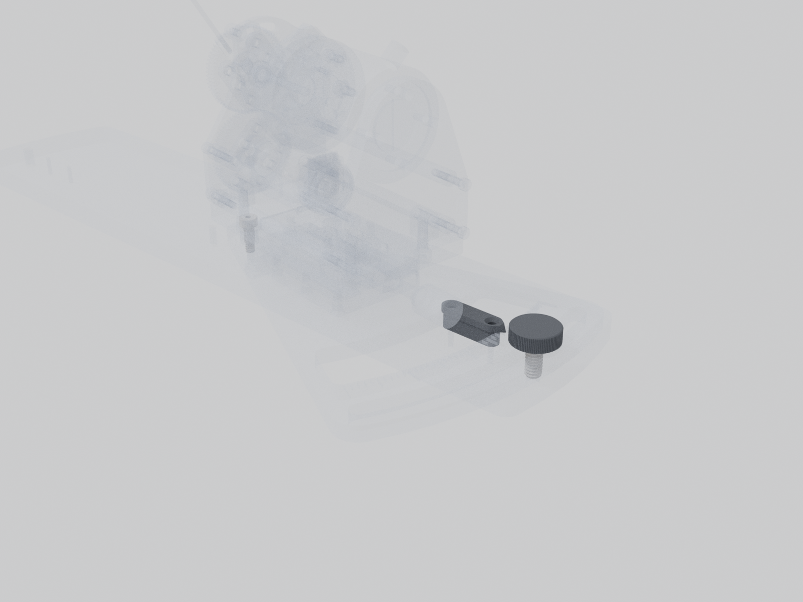

# Rotation indicator and lock

The pointer, the pivot shoulder screw and the knob that locks the rotation plate.

| | |
| --- | --- |
| Vendor | McMaster-Carr, Janelia (custom) |
| Part number | `94052A133, 92196A537, 90298A149` |
| Where | one per station |
| Model nodes | `ROTATION INDICATOR:*`, `MCMASTER 94052A133_Screw-Head Mount Knob:*`, `MCMASTER 92196A537_18-8 Stainless Steel Socket Head Screw:*`, `MCMASTER 90298A149_18-8 Stainless Steel Shoulder Screw:*` |

---

Generated by `atlas/pages.py` from `atlas/components.yaml`; edit the registry, not this page.
