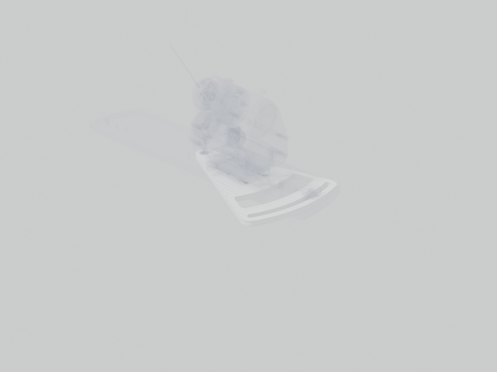

# Rotation plate

Plate under the linear stage that rotates on the base plate to set the station's angle; the indicator and lock knob read and hold it.

| | |
| --- | --- |
| Vendor | Janelia (custom) |
| Where | one per station |
| Model nodes | `ROTATION PLATE:*` |

---

Generated by `atlas/pages.py` from `atlas/components.yaml`; edit the registry, not this page.
