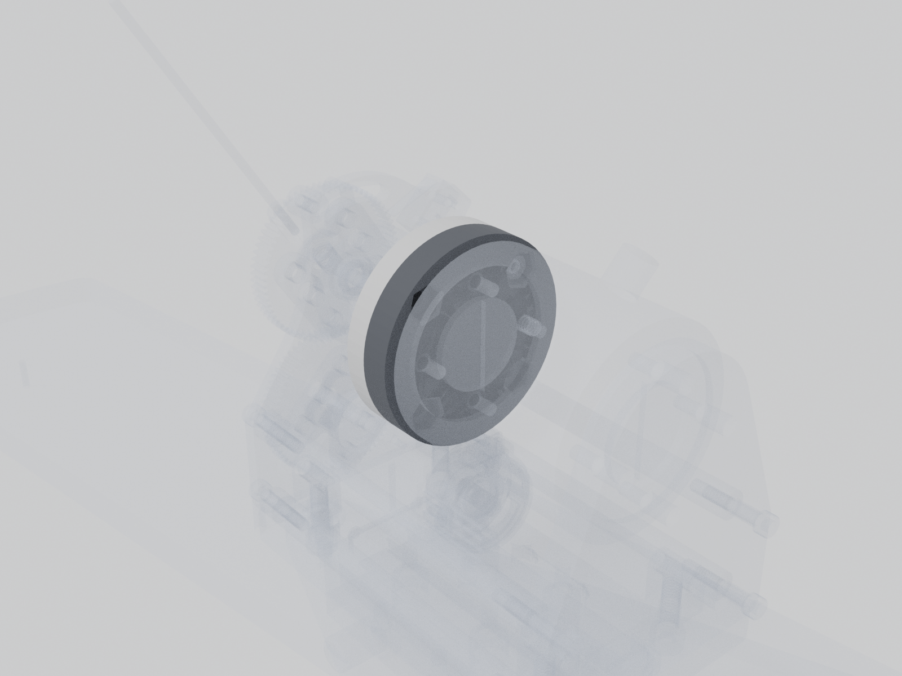

# Shaft couplers

Two couplers on the lever axis: one between the gear and the brake, one between the brake and the torque sensor.

| | |
| --- | --- |
| Vendor | Janelia (custom) |
| Where | one per station |
| Model nodes | `CouplerBrakeSide:*`, `Coupler-SensorSide:*` |

---

Generated by `atlas/pages.py` from `atlas/components.yaml`; edit the registry, not this page.
