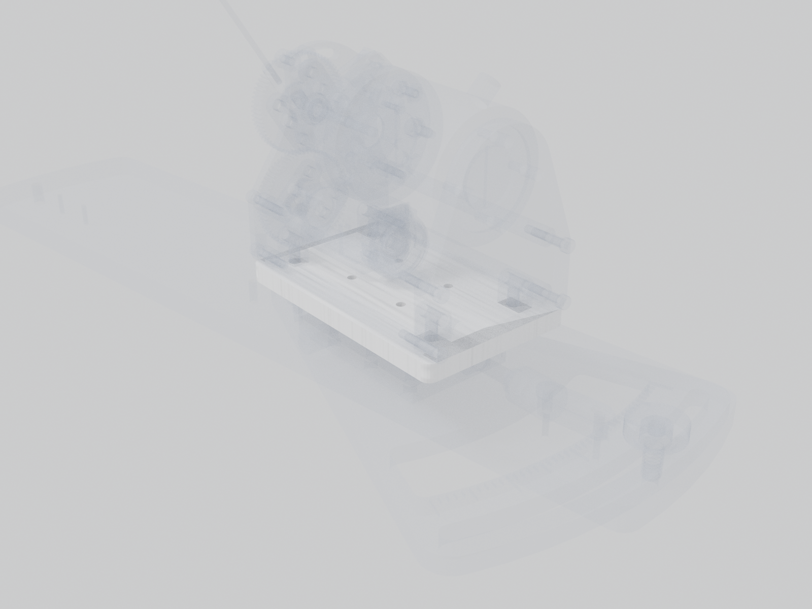

# Stage interface plate

Horizontal plate between the linear stage carriage and the station's frame.

| | |
| --- | --- |
| Vendor | Janelia (custom) |
| Where | one per station |
| Model nodes | `STAGE INTERFACE PLATE:*` |

---

Generated by `atlas/pages.py` from `atlas/components.yaml`; edit the registry, not this page.
