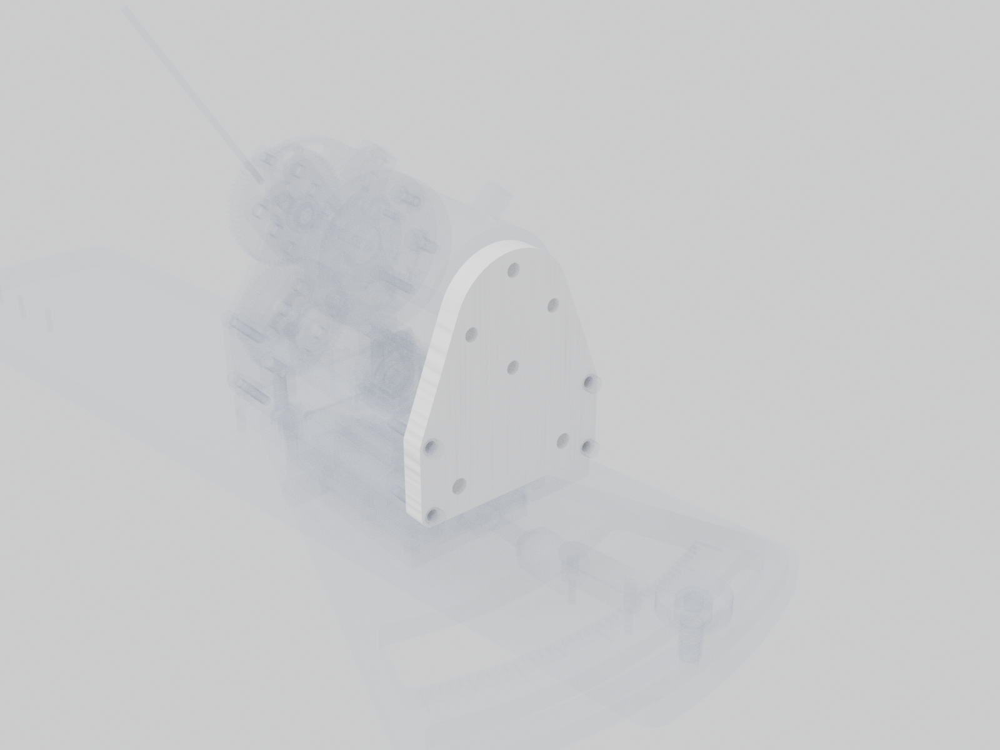

# Torque sensor plate

Vertical plate at the rear of the station carrying the torque sensor.

| | |
| --- | --- |
| Vendor | Janelia (custom) |
| Where | one per station |
| Model nodes | `TORQUE SENSOR PLATE:*` |

---

Generated by `atlas/pages.py` from `atlas/components.yaml`; edit the registry, not this page.
