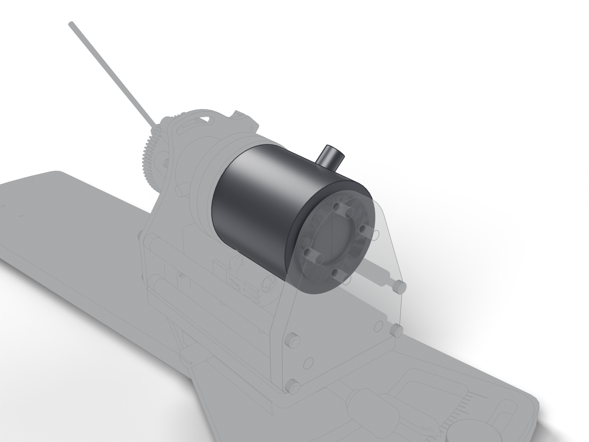

# Reaction torque sensor

350 ohm bridge, 1.5 mV/V, 5 in-oz, at the rear of the lever axis. The board excites it, amplifies it, samples it at 1 kHz and puts a copy on the torque BNC. The left station reads a pull negative where the right reads positive.

| | |
| --- | --- |
| Vendor | Transducer Techniques |
| Part number | `RTS-5` |
| Datasheet | [`mouse-joystick-pcb/docs/datasheets/torque-sensor-specs.png`](https://github.com/peterpolidoro/mouse-joystick-pcb/blob/v1.0/docs/datasheets/torque-sensor-specs.png) |
| Where | one per station |
| Model nodes | `TransducerTechniquesRTS5:*` |

## Connection

| Board | Connector | Cable |
| --- | --- | --- |
| [mouse-joystick-pcb](https://github.com/peterpolidoro/mouse-joystick-pcb/blob/v1.0/docs/interface-map.md) | `J2001` | [Torque sensor lead](torque-lead.md) |

## Circuit

Schematic block `brake_torque_sensor/torque_bridge_0_3v3_ina821` on the joystick board: [its page](https://peterpolidoro.github.io/mouse-joystick-pcb/generated/blocks/torque_bridge_0_3v3_ina821/) on the board's site has the schematic, the parts with their sourcing, the ports and where the block sits on the board; the [interface map](https://github.com/peterpolidoro/mouse-joystick-pcb/blob/v1.0/docs/interface-map.md) and the [schematic PDF](https://github.com/peterpolidoro/mouse-joystick-pcb/blob/v1.0/docs/generated/schematic/mouse-joystick-pcb-schematic.pdf) at the tagged revision cover the rest.

## Firmware

Files: [`mouse-joystick-firm/src/BrakeTorqueHw.hpp`](https://github.com/peterpolidoro/mouse-joystick-firm/blob/v1.0.0/src/BrakeTorqueHw.hpp), [`mouse-joystick-firm/src/ADS8689Device.hpp`](https://github.com/peterpolidoro/mouse-joystick-firm/blob/v1.0.0/src/ADS8689Device.hpp), [`mouse-joystick-firm/src/BoardCalibration.hpp`](https://github.com/peterpolidoro/mouse-joystick-firm/blob/v1.0.0/src/BoardCalibration.hpp)

Protocol: `TQ`, `STATUS (torque)`, `ev TOUCH`, `ev PULL / PUSH` ([protocol](https://github.com/peterpolidoro/mouse-joystick-pcb/blob/v1.0/docs/uart-protocol.md))

Proved by: [`mouse-joystick-firm/examples/BrakeAndTorque`](https://github.com/peterpolidoro/mouse-joystick-firm/blob/v1.0.0/examples/BrakeAndTorque), [`mouse-joystick-firm/docs/brake-torque-bringup.md`](https://github.com/peterpolidoro/mouse-joystick-firm/blob/v1.0.0/docs/brake-torque-bringup.md); measurements in the [bring-up log](https://github.com/peterpolidoro/mouse-joystick-pcb/blob/v1.0/docs/bringup-log.md) by board serial.

---

Generated by `atlas/pages.py` from `atlas/components.yaml`; edit the registry, not this page.
