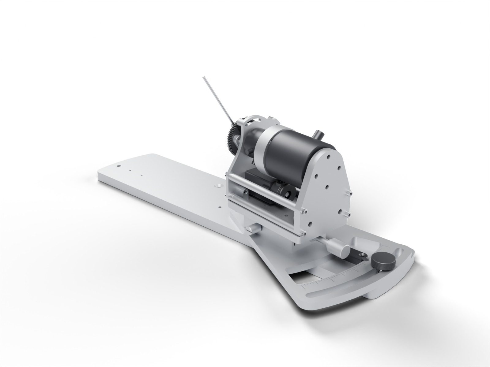
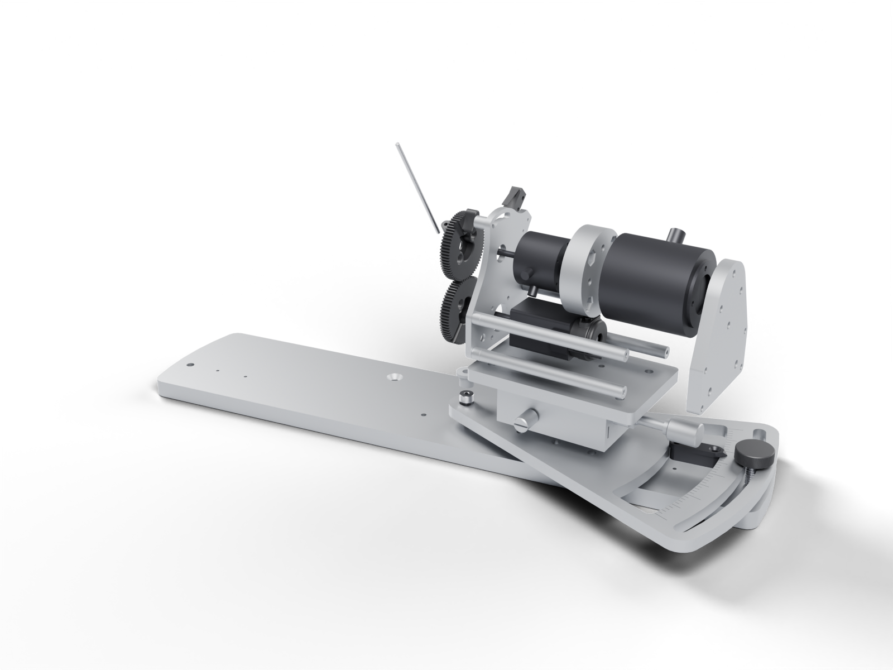
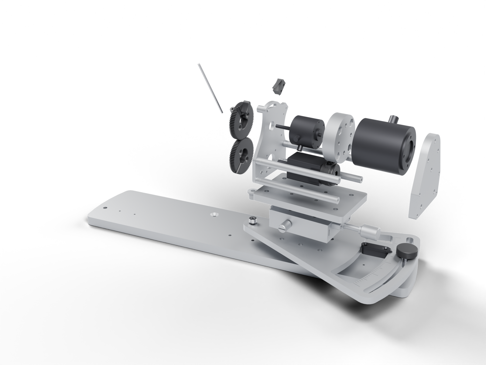

# One joystick station

The right station of the two-joystick assembly, which is the un-mirrored one;
the left station is its mirror image and takes the left harness.

## Exploded

Parts on the lever axis move along it: the lever and the gears forward, off the
motor mount plate; the brake, motor, couplers, torque sensor and its plate back.
The limit switch lifts off the plate; the stage interface plate, the linear
stage, the rotation plate and the base move down. The order of each part is the
registry's `explode` field; the distances come from the parts' sizes, so that
at 100 % no two parts intersect. Fasteners, bearings and the ServoCity shaft
hardware are omitted from these three views; the frame standoffs stay with the
motor mount plate and the parts slide along them.

## Parts

| Part | Order along the lever axis (negative: toward the lever) | Order downward (negative: up) |
| --- | ---: | ---: |
| [Joystick lever](components/lever.md) | -2 |  |
| [Spur gear pair](components/gear-train.md) | -1 |  |
| [Stepper motor](components/motor.md) | 1 |  |
| [Lever-axis encoder](components/encoder.md) | 1 |  |
| [Limit switch](components/limit-switch.md) |  | -1 |
| [Magnetic particle brake](components/brake.md) | 1 |  |
| [Reaction torque sensor](components/torque-sensor.md) | 3 |  |
| [Shaft couplers](components/shaft-couplers.md) | 2 |  |
| [Lever-axis bearings](components/lever-axis-bearings.md) | omitted | omitted |
| [Motor mount plate](components/motor-mount-plate.md) | 0 |  |
| [Torque sensor plate](components/torque-sensor-plate.md) | 4 |  |
| [Frame standoffs and spacers](components/frame-standoffs.md) | stays | stays |
| [Stage interface plate](components/stage-interface-plate.md) |  | 1 |
| [Linear stage](components/linear-stage.md) |  | 2 |
| [Rotation plate](components/rotation-plate.md) |  | 3 |
| [Rotation indicator and lock](components/rotation-lock.md) |  | 3 |
| [Dual base plate](components/dual-base-plate.md) |  | 4 |
| [ServoCity shaft hardware](components/servocity-parts.md) | omitted | omitted |
| [Fasteners](components/fasteners.md) | omitted | omitted |

The [mechanical bill of materials](bom-mechanical.md) counts every part.
