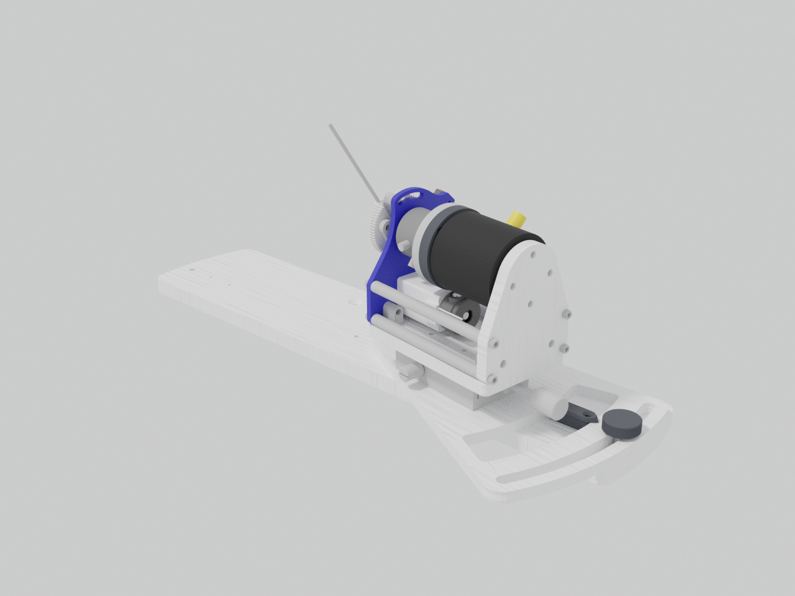
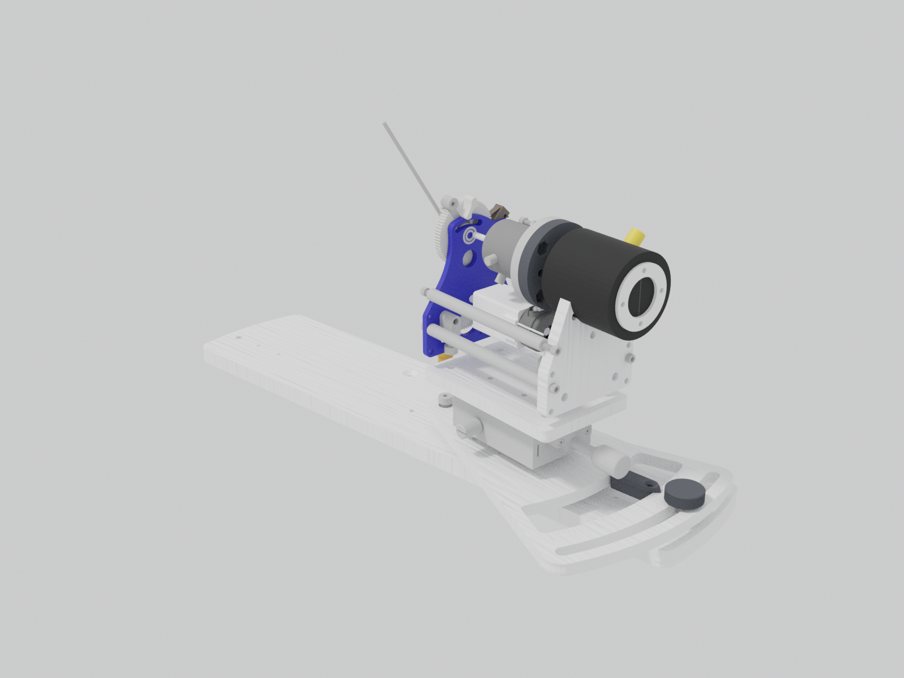
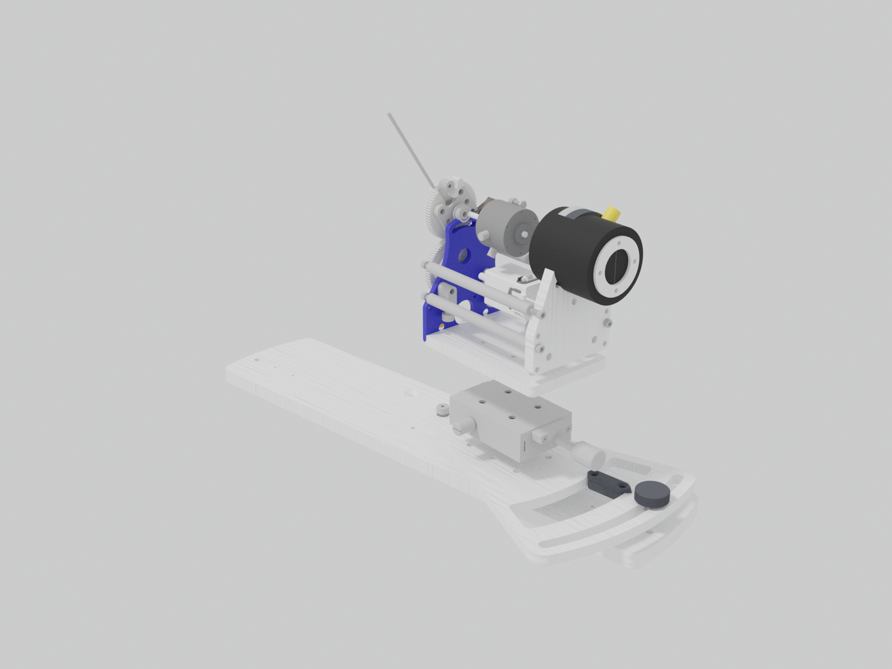
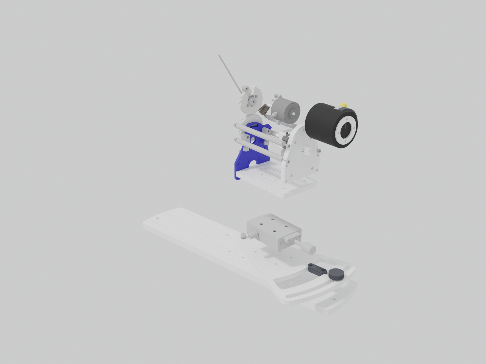

# One joystick station

The right station of the two-joystick assembly, which is the un-mirrored one;
the left station is its mirror image and takes the left harness.

## Exploded

Parts on the lever axis move along it away from the lever; the plates, the
stage and the base move down. Order from the registry's `explode` fields.

## Parts

| Part | Order along the lever axis | Order downward |
| --- | ---: | ---: |
| [Joystick lever](components/lever.md) | 0 |  |
| [Spur gear pair](components/gear-train.md) | 1 |  |
| [Stepper motor](components/motor.md) | 2 |  |
| [Lever-axis encoder](components/encoder.md) | 2 |  |
| [Limit switch](components/limit-switch.md) |  | 1 |
| [Magnetic particle brake](components/brake.md) | 3 |  |
| [Reaction torque sensor](components/torque-sensor.md) | 5 |  |
| [Shaft couplers](components/shaft-couplers.md) | 4 |  |
| [Motor mount plate](components/motor-mount-plate.md) |  | 2 |
| [Torque sensor plate](components/torque-sensor-plate.md) |  | 2 |
| [Stage interface plate](components/stage-interface-plate.md) |  | 3 |
| [Linear stage](components/linear-stage.md) |  | 4 |
| [Rotation plate](components/rotation-plate.md) |  | 5 |
| [Rotation indicator and lock](components/rotation-lock.md) |  | 5 |
| [Dual base plate](components/dual-base-plate.md) |  | 6 |

The [mechanical bill of materials](bom-mechanical.md) counts every part.
